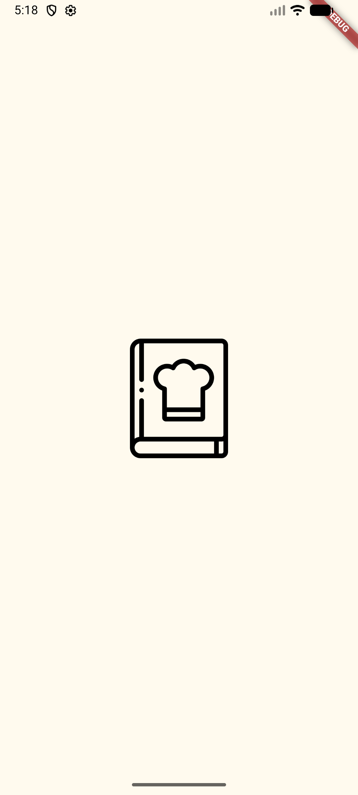
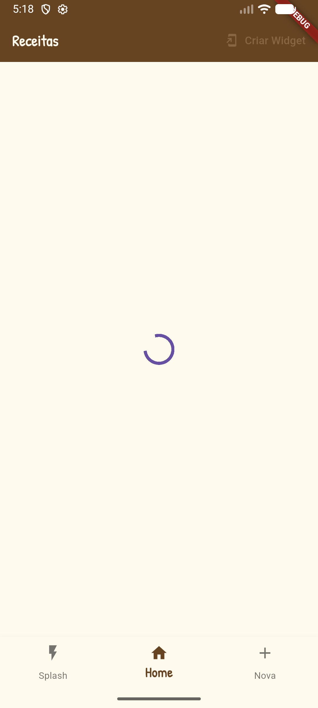
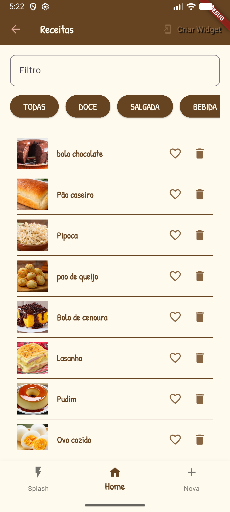
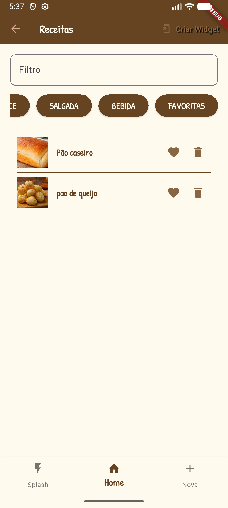
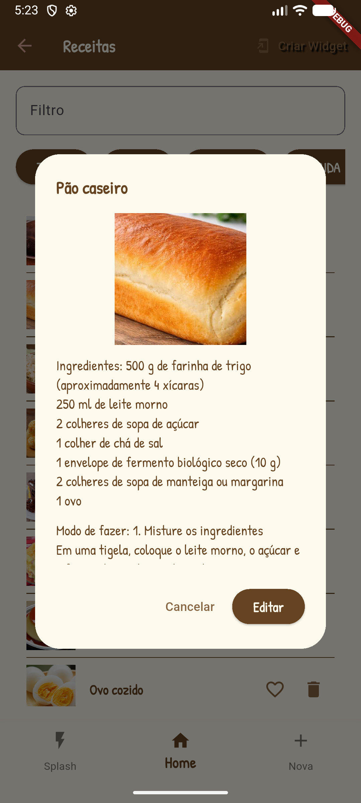
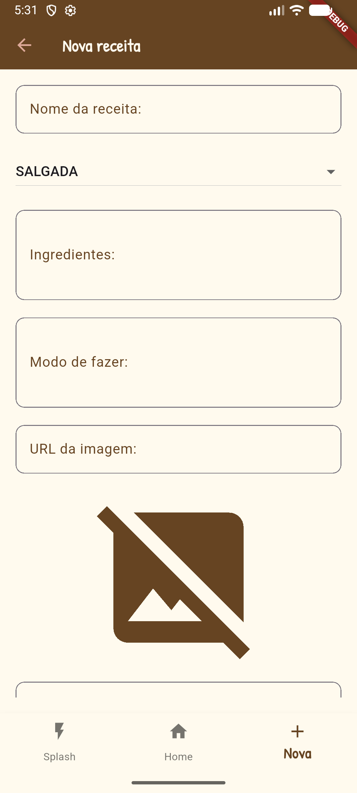
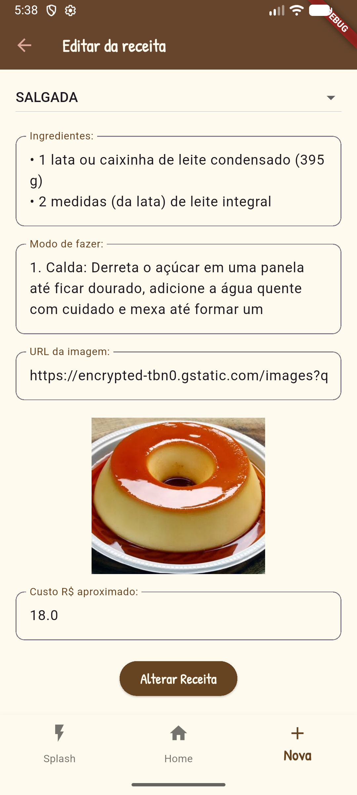
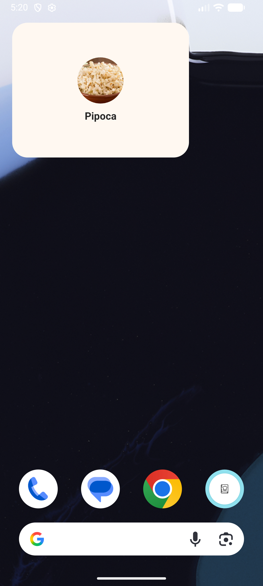

# Nossas Receitas
Flutter App que consome dados de uma API implantada na vercel que armazena dados de receitas em um banco de dados relacional
## Funcionalidades
- CRUD de Receitas
- WIdget que mostra uma receita aleatória
- Favoritar receitas e salvar localmente os IDs favoritos

## Dados da API
- API de um livro de Receitas implantada na **Vercel** [https://receitasapi-b-2025.vercel.app/](https://receitasapi-b-2025.vercel.app/)
- Repositório da API (Back-End) no [Github](https://github.com/wellifabio/receitasapp-expo-2025.git)
- Site do livro de Receitas [Web](https://wellifabio.github.io/receitas-web-2025/) consumindo a API
- Repositório do Site (Front-End) no [Github](https://github.com/wellifabio/receitasapi-b-2025)

## Tecnologias
- Flutter (Dart)
- VsCode
- Android Studio (Emulador)

## Como testar
- Clone este repositório
- Abra com VsCode, e com um terminal instale as dependências e execute em um Emulador ou Navegador
```bash
flutter pub get
flutter run
```
#### Se preferir instale o [.APK](./assets/app-release.apk) em celular Android

<details>
<summary>
<h2>Screenshots</h2>
</summary>

|||
|:-:|:-:|
|Splash|Carregando|
|||
|Home|Filtro|
|||
|Detalhes|Nova recelta|
|||
|Alterar|Widget personalizado|

</details>